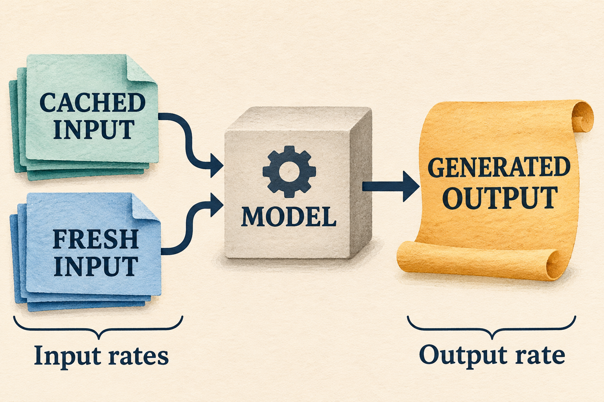

# DeepSeek API Pricing: Compare Providers and Estimate Your Costs

DeepSeek API pricing starts at $0.15 per million uncached input tokens and $0.60 per million output tokens for the official Flash API off-peak. Other providers set their own rates, so the cost of using DeepSeek also depends on where you access it and which configuration you choose.

Start with the question you need to answer:

- **Checking the official price?** The table below separates input, cached input and output, including peak rates.
- **Choosing a provider?** Compare DeepSeek direct, Morph, UnificAlly and Moduck using their published model prices.
- **Planning a monthly budget?** Use the formula and two worked examples to price your own token mix.

**Prices checked November 2, 2026.** This guide is prepared by Moduck, an AI API aggregator for developers and product teams.

These are **DeepSeek’s direct API prices in USD per 1 million tokens**, from [DeepSeek’s official rate card](https://api-docs.deepseek.com/quick_start/pricing/):

| Official API model | Input, cache miss: off-peak / peak | Input, cache hit: off-peak / peak | Output: off-peak / peak |
| --- | --- | --- | --- |
| `deepseek-flash` — V4.1-Flash-1017 | $0.15 / $0.30 | $0.003 / $0.006 | $0.60 / $1.20 |
| `deepseek-v4-pro` — V4-Pro-0813 | $0.66 / $1.32 | $0.022 / $0.044 | $1.98 / $3.96 |

Peak pricing applies **01:00–04:00 and 06:00–10:00 UTC, Monday through Friday, excluding Chinese public holidays**. Every other hour is off-peak, including weekends and those holidays.

The current model behind `deepseek-flash` is DeepSeek-V4.1-Flash-1017. DeepSeek says the older `deepseek-v4-flash` and `deepseek-v4-flash-vision-exp` names are still accepted, but now reach that model at Flash prices. Use the current served version when comparing a rate card with an older article.

*Conceptual illustration: the conditions behind a token quote belong in the budget.*

## What DeepSeek API providers charge

A provider’s input price answers only part of the buying question. Cached input and generated output have their own rates, and a time-based surcharge can change which option makes sense for your application.

Here are the providers’ published Flash prices, checked November 2, 2026. **All prices are USD per 1M tokens; input means cache-miss input.**

| Provider | Model / configuration | Rate period | Input | Cached input | Output |
| --- | --- | --- | ---: | ---: | ---: |
| [DeepSeek](https://api-docs.deepseek.com/quick_start/pricing/) | Flash 1017 | Off-peak | $0.15 | $0.003 | $0.60 |
| [DeepSeek](https://api-docs.deepseek.com/quick_start/pricing/) | Flash 1017 | Peak | $0.30 | $0.006 | $1.20 |
| [Morph](https://www.morphllm.com/pricing) | Flash 1017 | All hours | $0.12 | $0.008 | $0.80 |
| [UnificAlly](https://unifically.com/zh/blogs/deepseek-api) | Flash | Off-peak | $0.1125 | $0.00225 | $0.45 |
| [UnificAlly](https://unifically.com/zh/blogs/deepseek-api) | Flash | Peak | $0.225 | $0.0045 | $0.90 |
| [Moduck](https://moduck.ai/models/c/deepseek/deepseek-v4.1-flash) | Flash · FP4 | Published rate | $0.03776 | $0.00128 | $0.096 |

Model IDs: DeepSeek `deepseek-flash`; Morph `morph-dsv41flash-1017`; UnificAlly `deepseek/deepseek-flash`; Moduck `deepseek/deepseek-v4.1-flash`.

DeepSeek’s peak schedule is defined above. UnificAlly publishes peak/off-peak prices; Moduck’s model page gives the FP4 rates above without a separate time-band table.

Morph shows why a single headline rate can mislead. Its uncached input costs less than DeepSeek direct off-peak, while its cached input and output cost more. An application that reads large amounts of new text has a different comparison from one that generates long answers.

Moduck’s Flash prices are for **FP4**, a model precision/quantization configuration. Keep that specification beside the price when you build a shortlist. Compare the cost of the configuration you plan to use, then judge its answers against your application’s requirements. The budget table compares token costs; it does not claim every host and configuration produces identical results.

## Turn token rates into your own monthly estimate

Start with monthly billable token totals, not the number of people using your app. Ten short extraction calls can cost less than one long agent run, even when both end in a one-paragraph answer.

For each provider and each applicable billing period:

**Token cost = (cache-miss input ÷ 1,000,000 × miss rate) + (cache-hit input ÷ 1,000,000 × hit rate) + (billable output ÷ 1,000,000 × output rate).**

Add the periods together, then add separately billed tools and other applicable fees. If you start from requests, monthly input is requests × average input tokens, and monthly output is requests × average billable output tokens. Split input into hit and miss totals using measured usage. For thinking workloads, use the service’s billable output total, not just the visible final answer.

For DeepSeek direct, the response fields `prompt_cache_hit_tokens` and `prompt_cache_miss_tokens` distinguish the two input categories. [DeepSeek’s caching guide](https://api-docs.deepseek.com/guides/kv_cache) describes matching persisted prompt prefixes and best-effort cache behavior. Reusing a document is not a promise that every token will hit the cache. A cache discount affects qualifying input; it does not discount newly generated output. In the assistant example below, losing all assumed hits would raise direct off-peak cost from $24.36 to $42.00 at the same total input and output volumes.

If your logs do not yet separate peak usage, calculate an all-off-peak and an all-peak budget as bounds for the same token volumes. For a more specific estimate, split actual tokens into the correct time bins. The official price page does not settle every long-request boundary case; confirm how a request crossing a boundary is assigned before relying on a last-minute scheduling trick.

There is another line item for research agents. DeepSeek lists Search and Fetch at **$0.75 per 1,000 successful billable requests each**. Thus 10,000 billable searches plus 20,000 billable fetches add $7.50 + $15.00 = **$22.50**, separately from model tokens. The [Search & Fetch billing rules](https://api-docs.deepseek.com/guides/search) exclude failed requests and define a billable success. The page still says certain server-side calls are “currently free” while also stating billing starts November 1, 2026, Beijing time—a date already past at this check. Budget using the stated charging schedule and verify account treatment rather than assuming those calls remain free.

These estimates exclude taxes, payment or currency-conversion charges, any separate gateway fees, and extra retry/fallback usage. Hosted API token fees also remain separate from any chat-app offer or promotional credit. Do not assume a free balance applies to your account.

Initial funding and monthly consumption are different amounts. [Moduck](https://moduck.ai/pilot/pricing) publishes a $10 minimum top-up and no fixed monthly fee. A token budget below $10 therefore does not mean you can begin with that smaller payment. The examples below use standard rates without promotional credit.

*Conceptual billing view. Cache pricing applies to qualifying input; generated output uses its own rate.*

## The cheaper route changes with the workload

Consider two applications over a 30-day month. These are planning examples using published prices, not customer bills or performance benchmarks. Each provider is assigned the **same token volumes and cache share** to isolate the rate differences. Actual cache hits depend on the workload and host.

| Assumption | Input-heavy assistant | Output-heavy generator |
| --- | --- | --- |
| Requests per month | 100,000 | 50,000 |
| Average input tokens per request | 2,000 | 1,000 |
| Average billable output tokens per request | 200 | 2,000 |
| Total input / output | 200M / 20M | 50M / 100M |
| Cache-hit share of input | 60% | 10% |
| Peak share, where time-band rates apply | 25% of each input/output category | 25% of each input/output category |

The assistant has 120M cached input, 80M uncached input and 20M output tokens. On DeepSeek direct, all-off-peak token cost is:

**120 × $0.003 + 80 × $0.15 + 20 × $0.60 = $24.36.**

With 25% of each category charged at double rates, the mixed-period estimate is **$24.36 × (0.75 + 0.25 × 2) = $30.45**. At 100% peak, the same tokens cost **$48.72**. Nothing about the model, token volume or cache ratio changed in that timing comparison.

Here are the monthly token costs using each provider’s published rates, rounded to the nearest cent after calculating the full total:

| Provider-rate calculation | Input-heavy assistant | Output-heavy generator |
| --- | ---: | ---: |
| DeepSeek direct, all off-peak | $24.36 | $66.77 |
| DeepSeek direct, 25% peak | $30.45 | $83.46 |
| DeepSeek direct, all peak | $48.72 | $133.53 |
| Morph, listed all-hours rates | $26.56 | $85.44 |
| UnificAlly, published rates with 25% peak | $22.84 | $62.59 |
| Moduck FP4, published model rates | $5.09 | $11.31 |

### An assistant can favor different routes at different hours

Morph’s assistant calculation is **80 × $0.12 + 120 × $0.008 + 20 × $0.80 = $26.56**. That sits between DeepSeek direct’s all-off-peak and mixed-period estimates. A nightly document-processing job can be scheduled for the lower rate; a customer waiting for an answer usually cannot. Use the hours your application needs to operate when choosing between those quotes.

For the same assistant workload, Moduck’s published FP4 rates give **80 × $0.03776 + 120 × $0.00128 + 20 × $0.096 = $5.0944**, rounded to $5.09. Use this figure when budgeting for the FP4 configuration in the rate table.

### Long answers change which rate matters most

The generator uses 45M uncached input, 5M cached input and 100M output tokens. DeepSeek direct costs **45 × $0.15 + 5 × $0.003 + 100 × $0.60 = $66.765** off-peak, or $83.45625 with the assumed 25% peak share. Morph’s $85.44 now sits above both estimates. Its lower uncached-input price does less for an application that spends most of its budget generating answers.

At Moduck’s FP4 rates, the same token volumes cost **45 × $0.03776 + 5 × $0.00128 + 100 × $0.096 = $11.3056**. Output accounts for $9.60 of that total; it also accounts for $60 of the direct off-peak total. For this workload, controlling answer length and unnecessary regeneration can matter more than improving the small cached-input share.

UnificAlly’s estimates apply its own rate card with the same 25% peak assumption. For example, the generator is **(45 × $0.1125 + 5 × $0.00225 + 100 × $0.45) × 1.25 = $62.5921875**. Moduck’s page lists no separate peak/off-peak prices, so its calculation uses the published rates without a time adjustment.

Replace these assumptions with your measured usage as it becomes available. Keep model configuration and answer quality alongside the token-cost estimate when making your final choice.

## Choose a route that fits your workload

For schedulable jobs, compare the direct off-peak bill with each provider’s workload total. For interactive applications, use a realistic mix of billing periods. Morph’s input rate deserves a look for reading-heavy work; its higher output rate matters for long answers. Include UnificAlly’s time bands and Moduck’s FP4 configuration when comparing their quotes.

If Moduck’s published pricing and FP4 configuration suit your workload, you can [Get API Key](https://moduck.ai/dashboard/api-keys) to begin setup. Sign-in is required; use the [model documentation](https://docs.moduck.ai/en/models/library/text-models-llm/deepseek-ai/deepseek-flash) for integration details.
