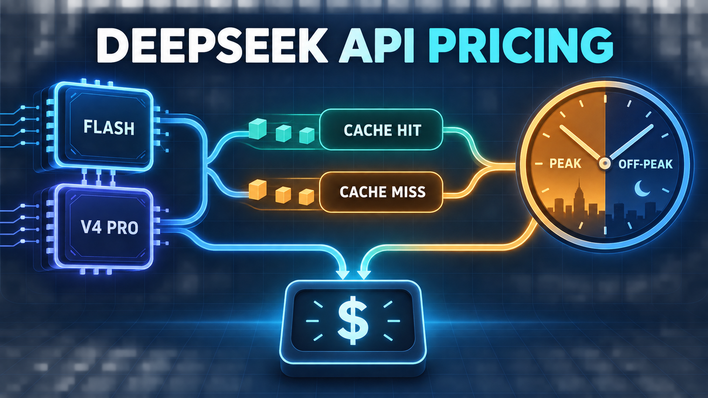
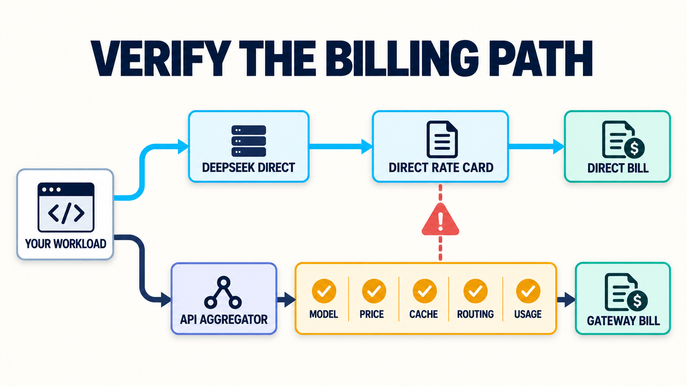

# DeepSeek API Pricing 2026: Calculate Cost by Model, Cache Hits, and Peak Hours

*Generated conceptual illustration of the pricing inputs discussed below; it is not a DeepSeek or Moduck product interface.*

A useful DeepSeek API pricing estimate has three lines: cache-hit input, cache-miss input, and output. Each line has a peak and off-peak price. Choose the current model, count each token category separately, then apply the price for the window in which those tokens were processed.

The table below reflects [DeepSeek’s Models & Pricing page](https://api-docs.deepseek.com/quick_start/pricing/) as checked on October 27, 2026. DeepSeek identifies `deepseek-flash` as DeepSeek-V4.1-Flash-1017 and `deepseek-v4-pro` as DeepSeek-V4-Pro-0813. Prices can change, so recheck the source before approving a budget.

| Price per 1M tokens (USD) | Flash off-peak | Flash peak | V4 Pro off-peak | V4 Pro peak |
|---|---:|---:|---:|---:|
| Cache-hit input | $0.003 | $0.006 | $0.022 | $0.044 |
| Cache-miss input | $0.15 | $0.30 | $0.66 | $1.32 |
| Output | $0.60 | $1.20 | $1.98 | $3.96 |

Peak hours are 01:00–04:00 and 06:00–10:00 UTC, Monday through Friday, excluding Chinese public holidays. All other hours are off-peak, including weekends and Chinese public holidays. The listed peak rates are twice the off-peak rates. A single blended input price is therefore useful only after you know both the cache mix and the time mix.

Add Search and Fetch as separate request charges if your application uses them. DeepSeek lists each standalone API at $0.75 per 1,000 successful requests.

This article uses documented rates and hypothetical arithmetic. No DeepSeek account, model request, payment, or bill was tested for this research.

## Use one formula, then split it by time window

Start with three monthly token totals for one model:

- **H** = input tokens billed as cache hits
- **M** = input tokens billed as cache misses
- **O** = output tokens

For any one time window, the formula is:

> **Cost = (H ÷ 1,000,000 × cache-hit price) + (M ÷ 1,000,000 × cache-miss price) + (O ÷ 1,000,000 × output price)**

If some traffic runs at peak and some off-peak, split H, M, and O into peak and off-peak totals and run the formula twice. Then add the two subtotals. This is the safest method because your peak share may differ by category: a nightly batch could contain most of your input while interactive daytime traffic produces most of your output.

There is a shortcut when the same peak share applies to all three categories. Every current peak price in the table is exactly twice its off-peak counterpart. Multiply the off-peak subtotal by `1 + p`, where **p** is the share of tokens processed at peak. A 35% peak share means a multiplier of 1.35. Do not use that shortcut if the categories have different schedules.

Treat cache hit rate as a share of **input tokens**, not a share of requests. Suppose 90 small requests hit the cache but 10 very large requests miss. A “90% of requests hit” label could still conceal most input tokens being billed at the miss rate. Weighting by tokens keeps the estimate aligned with billing.

For planning, H and M may begin as assumptions. Once requests are running, replace them with the response usage fields described later. DeepSeek’s [token-usage documentation](https://api-docs.deepseek.com/quick_start/token_usage/) says actual processed token counts in usage results are the source of truth; rough word or character conversions are only estimates.

## Worked example: one workload, two models, three schedules

Consider a hypothetical application with:

- 1,000,000 calls per month
- 2,000 input tokens per call
- 500 output tokens per call
- 60% of input tokens billed as cache hits
- 35% of every token category processed during peak windows

That produces 2 billion input tokens and 500 million output tokens. Applying the assumed cache mix gives 1.2 billion cache-hit input tokens and 800 million cache-miss input tokens.

For Flash at off-peak rates, the monthly subtotal is:

> `(1,200 × $0.003) + (800 × $0.15) + (500 × $0.60) = $423.60`

The numbers are in millions of tokens, which is why 1.2 billion becomes 1,200 rate units. With 35% of each category at peak, the shortcut multiplier is 1.35, producing `$423.60 × 1.35 = $571.86`.

The same workload at V4 Pro’s off-peak rates is:

> `(1,200 × $0.022) + (800 × $0.66) + (500 × $1.98) = $1,544.40`

Applying the same time mix gives `$1,544.40 × 1.35 = $2,084.94`.

| Model | Off-peak only | Peak only | 35% of tokens at peak |
|---|---:|---:|---:|
| `deepseek-flash` | $423.60 | $847.20 | $571.86 |
| `deepseek-v4-pro` | $1,544.40 | $3,088.80 | $2,084.94 |

These totals answer only the cost question. Choosing Flash because this table is lower would require a separate finding that Flash meets your task, feature, output-quality, and operational requirements. No comparable performance or latency test was run here.

Notice one less obvious result: in the Flash off-peak calculation, output costs $300, while all input costs $123.60. A high cache-hit share makes input inexpensive, but it does not discount output. For this workload, controlling output length can matter more than pushing the cache-hit share a little higher.

## Test the assumptions that can move the total

A base estimate becomes more useful when you deliberately try to break it. The table below keeps the Flash workload from the previous section and changes one assumption at a time.

| Flash scenario | Changed assumption | Estimated monthly cost |
|---|---|---:|
| Base | 60% input-token cache hit, 500 output tokens/call, 35% peak | $571.86 |
| No cache hits | 0% input-token cache hit | $810.00 |
| High cache reuse | 90% input-token cache hit | $452.79 |
| Shorter output | 250 output tokens/call | $369.36 |
| Longer output | 1,000 output tokens/call | $976.86 |
| Off-peak only | 0% peak | $423.60 |
| Peak only | 100% peak | $847.20 |

These are calculated scenarios, not observed spend. Their value is in showing which input deserves measurement.

In this example, moving from no cache hits to 90% cache-hit input changes the estimate by $357.21. Doubling output from 500 to 1,000 tokens per call adds $405.00 relative to the base. The longer-output case therefore costs more than the no-cache case, even though 60% of input still receives the cheap cache-hit rate. The cheapest input line does not cap the total bill.

Peak exposure has a clean effect under the current rate card because all peak rates are double: an all-peak workload costs exactly twice its all-off-peak counterpart. Real traffic is rarely so uniform, so measure peak shares for hit input, miss input, and output separately when possible.

Use at least three budget cases:

- **Low:** shorter output, stronger measured prefix reuse, and only genuinely deferrable work off-peak.
- **Base:** calls and token volumes supported by current product assumptions or a representative pilot.
- **High:** longer output, weaker cache reuse, and more peak traffic than planned.

The conclusion should change if the high case exceeds the budget, if the lower-priced model fails the task, or if an operational requirement prevents moving work. Those are reasons to redesign the workload or test another model. Hiding the uncertainty inside one blended rate will not resolve it.

## Measure cache-hit tokens instead of guessing

DeepSeek enables caching by default; there is no billing flag to activate it. Its [context-caching guide](https://api-docs.deepseek.com/guides/kv_cache/) says a later request gets a hit only when it fully matches a prefix unit that has already been persisted.

That makes prompt structure relevant. A stable system prompt and repeated document prefix can become reusable after a matching prefix unit has been persisted. Inserting changing content near the beginning can reduce reusable prefix length. The guide also describes caching as best-effort, not a guaranteed 100% hit mechanism. Cache construction takes time, and unused cache is generally cleared within hours to days. A planning spreadsheet should not turn a tidy prompt layout into a guaranteed hit rate.

The API response provides the two billing inputs you need:

- `prompt_cache_hit_tokens`
- `prompt_cache_miss_tokens`

Measure those token counts instead of labeling entire requests “hit” or “miss.” A request can contain both categories, and different request sizes make a request-level percentage misleading. Token-level totals let finance reconcile the estimate to the same units the rate card uses.

A simple measurement loop is enough:

1. Record model, request time in UTC, `prompt_cache_hit_tokens`, `prompt_cache_miss_tokens`, and output tokens for each response.
2. Aggregate those values by model and peak/off-peak window across every traffic pattern included in the budget.
3. Recalculate the bill with the current official rate table.
4. Compare actual category shares with the low, base, and high cases.
5. Investigate changes in prefix layout or traffic mix before attributing a cost change to the rate card.

Caching only changes how matching input is retrieved and billed. It does not turn output into cached input, and it does not make generated output deterministic. Keep output tokens as their own line in every forecast.

## Use off-peak pricing only for work you can actually defer

The current peak windows are 01:00–04:00 and 06:00–10:00 UTC on Monday through Friday, except Chinese public holidays. Weekends, Chinese public holidays, and all other hours are off-peak. Convert those windows to the scheduler’s timezone, but keep UTC in the billing dataset so daylight-saving changes do not silently shift your classification.

Potential candidates for deliberate off-peak scheduling include offline evaluation, backlog summarization, document indexing, and reports with a flexible completion time. Their deadlines and capacity needs still require testing. Interactive chat, user-triggered agents, and latency-sensitive product flows are different: delaying a response solely to obtain a token discount may damage the product decision that the API is meant to support.

For mixed traffic, calculate the peak share from token volume, not job count. A few long batch jobs can carry more tokens than thousands of short interactive calls. If hit input, miss input, and output follow different schedules, split each category rather than applying one overall percentage.

Capacity requires a separate check. DeepSeek’s [Rate Limit & Isolation page](https://api-docs.deepseek.com/quick_start/rate_limit/) lists account-level concurrency limits of 2,500 for `deepseek-flash` and 500 for `deepseek-v4-pro` as of the research date. A compressed off-peak batch still needs to prove it can complete within your deadline. Queue shape, request duration, retry behavior, and the current account limit still need an operational test.

The practical rule is narrow: move work only when it is genuinely deferrable, then verify that the denser schedule still meets the workload’s completion and reliability requirements.

## Direct DeepSeek or an API aggregator? Verify the billing path

The formula in this article describes DeepSeek’s documented direct API rates. Do not assume it transfers unchanged to a gateway. An aggregator may expose a different model identifier, price, cache treatment, routing policy, usage record, or billing unit.

*DeepSeek’s direct rate card applies to the direct path. An aggregator budget requires separate verification of the exact model, price, cache treatment, routing policy, and usage records.*

Moduck publishes this article and is an AI API Aggregator and Unified AI API Platform for developers and product teams. That relationship makes the distinction important: this article does not establish that a particular DeepSeek model is currently available through Moduck or that DeepSeek’s direct cache and peak discounts pass through unchanged.

Choose the path by verifying the terms that affect your workload:

| Question | Why it changes the decision |
|---|---|
| Is the exact model and version available? | A similar display name is not proof of the same model or billing column. |
| What are the input, output, and cache units? | The direct formula works only when the categories map cleanly. |
| Are peak/off-peak rates passed through? | A flat gateway price can remove both the discount and the scheduling incentive. |
| Can you export usage by model and token category? | Without comparable usage, budget reconciliation becomes harder. |
| Does routing change the provider or model? | Routing can improve operational flexibility while making provider-specific cost assumptions invalid. |
| What account, support, and concurrency terms apply? | Operational consolidation and the lowest direct rate are different decisions. |

Direct DeepSeek is the cleaner choice when you need its exact price mechanics, model surface, and usage fields and are willing to operate that provider integration. An aggregation layer may fit when consolidating integrations or model discovery matters more. Confirm its current model, price, cache, routing, and account terms first; otherwise the direct-API estimate cannot serve as the gateway budget.

If an aggregation layer fits those operational needs, inspect Moduck’s current documentation before you commit. [Read the documentation](https://docs.moduck.ai/).

Verify the exact model, price, and account conditions for your workload.

Treat the documentation link as a research step, not as confirmation of DeepSeek availability, matching rates, or account eligibility.

## Build a range now; replace assumptions with usage next

Before approving a DeepSeek API budget, make the worksheet auditable. Record the model and version, cache-hit input tokens, cache-miss input tokens, output tokens, the peak/off-peak split for each category, and any standalone Search or Fetch requests. Keep the USD rate, rate unit, source URL, and check date beside the calculation so a future price change is easy to isolate.

Then produce three numbers, not one:

1. a low case with only supportable cache and scheduling assumptions;
2. a base case tied to the product’s expected token mix;
3. a high case that covers longer output, weaker reuse, or more peak traffic.

After integration, replace estimates with `prompt_cache_hit_tokens`, `prompt_cache_miss_tokens`, output usage, the actual model, and UTC request time. Reforecast from those fields before concluding that the model, cache layout, or rate card caused a variance.

Cost alone cannot select the model. Task quality, required features, latency, concurrency, and the billing path can reverse the cheapest-looking answer. The defensible decision is the model and access path that meet those requirements inside the measured cost range.
